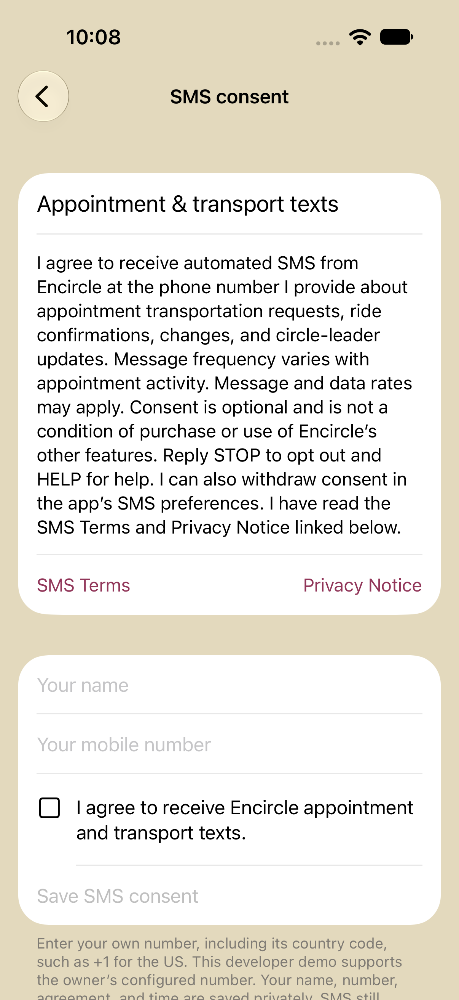

# Encircle SMS signup and consent

This public document describes the actual in-app opt-in flow for **Encircle appointment and transport messages**. It is evidence of the signup mechanism, not a public list of subscribers or consent receipts.

## Where the form appears

Open Encircle on iPhone, then **Menu → Apple Calendar & transport → SMS consent & preferences**. The same screen is linked from **Care coordinator** and, after phone sign-in, **Menu → Your account → SMS consent & preferences**.

Signed-in users read the disclosure and linked SMS Terms/Privacy Notice. Their verified sign-in number is prefilled and cannot be changed on this screen; the name can be edited. The person explicitly checks the initially **unchecked** agreement box, then taps **Save SMS consent**. The save button stays disabled until the name and number are present and the box is checked. Users who have not signed in see a link to phone sign-in; the original owner-demo form remains available separately. Checking the box alone does not submit consent. Other app features remain available without opting into SMS.

## Disclosure shown in the app

> I agree to receive automated SMS from Encircle at the phone number I provide about appointment transportation requests, ride confirmations, changes, and circle-leader updates. Message frequency varies with appointment activity. Message and data rates may apply. Consent is optional and is not a condition of purchase or use of Encircle’s other features. Reply STOP to opt out and HELP for help. I can also withdraw consent in the app’s SMS preferences. I have read the SMS Terms and Privacy Notice linked below.

Checkbox label: **I agree to receive Encircle appointment and transport texts.**

[SMS Program Terms](SMSTerms.md) · [SMS Privacy Notice](SMSPrivacy.md)

These documents are also readable inside the consent screen under **Privacy & terms**. Each page includes **Copy URL** and **Open public page** controls. For Twilio’s **Privacy Policy URL**, use the public privacy-notice link above; for **Terms & Conditions URL**, use the public program-terms link. The in-app copies are bundled with the app and remain available offline.

## Actual iPhone screenshots

This shows the original owner-demo form in the running app with blank fields and an unchecked consent box. Signed-in account users see the same disclosure and unchecked box, with their verified number prefilled. No subscriber data is published.

## Private consent receipt and enforcement

On explicit submission, the authenticated app sends the agreement to the Oracle backend. It records the person's name and number, server time, exact disclosure/version, source (`ios_app`), and receipt ID. User-account consent is bound to the verified phone identity and stored privately in Oracle NoSQL with a bounded history of 10 consent changes. Only that user can read or change it; another user's number is rejected. It does not automatically enroll anyone in transport messaging. The original owner-demo consent remains in private versioned Object Storage and is required before the legacy demo dispatches live SMS, including automatic activation. Old checkbox states are not reused when the screen loads.

Withdrawal is available on this screen after acceptance and records the user's choice. New user-account transport messaging is not connected yet. Withdrawal from the original owner demo suppresses its future queued messages. SMS STOP opt-outs apply to every role using that phone; app acceptance does not clear a provider STOP. Delivery already submitted to the carrier cannot be recalled. No phone number or completed consent receipt is hosted at this public URL.

## Program and current deployment

The app coordinates outbound and return rides for appointments, using explicit request codes and a leader notification after confirmation. Sample appointments and messages are marked DEMO during development. Consent can be saved by any phone-verified account. The existing transport sender remains limited to the owner's configured demo number, which may represent both demo roles; new circles are not connected to that sender or to Epic/a real patient record system. User-requested sign-in codes are enabled for US/Canada numbers, subject to Twilio's trial recipient rules; saving a consent record does not bypass those rules. Real SMS remains subject to Twilio/carrier approval and trial recipient verification. This documentation does not assert approval or eligibility for a purely personal messaging use case.

### Example operational message (fictional data)

> Encircle DEMO: Hi Ted, can you take Terraica to the appointment on Nov 03, 2026 at 05:00 PM CST? Reply YES A1B2C3D4E5 or NO A1B2C3D4E5. STOP to opt out.

## For the verification reviewer

This is an **in-app digital opt-in form**, not a text-keyword signup campaign, verbal agreement, or QR-code flow. The form is inside the authenticated iPhone app, so the screenshots are publicly hosted here for review. The named app, disclosure, screenshots, privacy notice, and program terms describe the same program. Consent records stay private. Technical source is available in this public repository.

Disclosure version: `2026-10-18-encircle-v2`.

Twilio's guidance permits public screenshots for an authenticated app's consent flow: [opt-in evidence URL requirements](https://www.twilio.com/docs/api/errors/30509). A valid opt-in mechanism does not remove use-case eligibility requirements.
