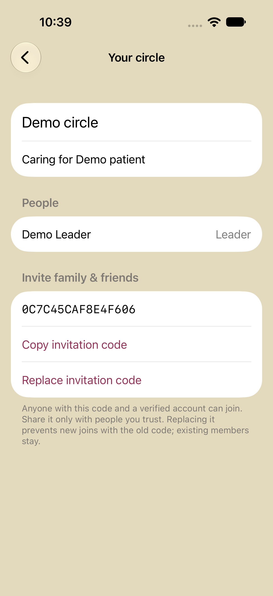
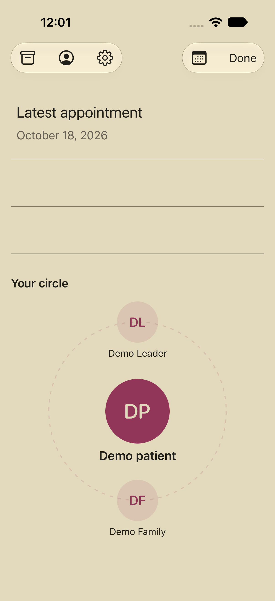

# Phone sign-in and circles

Open **Menu → Your account** (the person icon). Enter your own name and mobile number, request a sign-in code, and enter the six-digit code from your text. New users are created only after Twilio Verify approves the code. Returning users sign in to their existing account; they can update their name separately.

Choose **Create a circle**, enter a circle name and the name of the person receiving care, and become its leader. The circle detail shows members and a 16-character invitation code. Copy it and share it directly with people you trust. The leader can replace the code to stop further joins using the old one. Replacing a code does not remove existing members.

Choose **Join a circle**, enter the invitation code and select **Family** or **Friend**. Members see each other's names and roles, not phone numbers. Only the leader sees or replaces the invitation code. Members can leave; transferring leadership and deleting a circle are not implemented yet.

## What is connected

Accounts, verified phone identities, session hashes, circles, and memberships persist in the **EncircleUsers** Oracle NoSQL database table in Chicago. Oracle instance identity gives the backend read/write access to rows in that table only, without table administration permission. Provider credentials stay on the server. Session tokens are stored in the iPhone Keychain, are hashed in the database, expire after 30 days, and are revoked at sign-out. At most three devices remain signed in per user.

Recorded visits, transcripts, summaries and playback are now shared privately with current members of the selected circle; see [recording and migration](VisitRecordingPlan.md). The original single-owner synthetic scheduling feed, transport coordinator and calendar transport plan remain separate. Account tokens cannot access those legacy owner endpoints. Old phone recordings are shared only after the user chooses a destination circle; demo contacts are not automatically copied.

Phone verification does not grant transport-SMS consent, configure trusted transport contacts, or send appointment requests. Signed-in users can save or withdraw consent for their verified phone number in **Your account → SMS consent & preferences**; the number is prefilled and cannot be replaced with someone else's. These records and their latest 10 changes persist privately in Oracle NoSQL. They do not enroll users into the legacy transport demo, which continues to use its separate owner consent.

## Circle display and photos

The bottom of the appointment menu displays the selected circle, with the person receiving care at its center. Member names and photos appear around a dashed ring; initials stand in for missing photos. More than six members appear on additional swipeable pages.

In **Your account**, choose **Add profile picture** to select a photo from the system photo picker. Settings also links to **Profile pictures & your circle**. Each signed-in user controls their own photo. The circle leader can set the patient's photo from the circle detail. Photos are center-cropped to 384 pixels, JPEG-compressed and stripped of source metadata before uploading; the server accepts at most 200 KB. Photo bytes live in the private, versioned Oracle visits bucket; only revision identifiers live in the account directory. No public image URLs are created. Every photo read rechecks sign-in and membership; leaving a circle removes access to that circle's patient and member photos. Profile photos are shared across the user's circles.

## Current trial restriction

`TWILIO_VERIFY_SELF_SERVICE=1` enables user-requested sign-in codes for US/Canada numbers, independently of the transport recipient allowlist. Twilio's trial still requires verified recipient numbers: a person whose number has not been verified in Twilio cannot receive a trial sign-in code. Add each test number to Twilio's verified recipients with its owner's participation, or upgrade the account before general sign-in. Provider failures never become successful sign-ins. This does not bypass messaging rules or expand the transport-demo allowlist. No real verification text is sent by tests or provisioning.

The prototype limits verification starts to five per UTC day globally, one per phone per minute, five checks per challenge, and a 10-minute code lifetime. The authenticated/public account routes share the backend's 30 requests/minute limit. Failed or uncertain send attempts consume a start slot to prevent repeat charges. Trial texts use Twilio Verify rather than the transport sender. Verify charges are additional to transport SMS.

## Provision and deploy

Use the existing private Oracle/Twilio configuration, then run:

```sh
Server/.venv/bin/python Server/Cloud/prepare_users.py
Server/.venv/bin/python Server/Cloud/deploy.py --paid-small-server --replace-server
```

Preparation reuses the named table and verification service; it never sends an SMS or creates a user. The table now reserves 256 read units, 128 write units and 1 GB storage to support concurrent circle-membership checks and account changes. This increases database charges above the initial 10/10-unit setup; Verify, visit storage and AI charges are additional. Preparation verifies that the capacity increase has taken effect instead of relying on an asynchronous update acknowledgment. This is a paid table because the free-table request was rejected in Chicago. Deployments preserve it. Private table/service identifiers are written to the ignored server environment and local cloud state.

For this small prototype, the directory is a single atomic JSON row with conditional writes, a 240 KB payload ceiling, at most 100 users/100 circles, 20 members per circle, and 10 circles per person. It is a bounded prototype, not an unlimited account service. Split into separate partitioned records and add account recovery/deletion, membership removal, abuse controls before broader deployment. Recorded-visit access already checks current circle membership on each request.

Account routes: public `POST /users/auth/start`, `POST /users/auth/check`; session-protected `GET /users/me` and `POST /users/profile`, `/users/logout`, `/users/circles/create`, `/users/circles/join`, `/users/circles/rotate`, `/users/circles/leave`; plus session-protected `GET/POST /users/sms/consent`. Account tokens and the legacy owner connection token are not interchangeable.

## Verification

Backend tests cover approval, invalid/expired/replayed codes, attempt limits, session expiry/revocation, identity preservation, circle privacy, leader-only invitation changes, membership isolation, leaving, and concurrent joins. The native simulator flow uses `Tests/account_test_server.py`, bound to localhost with synthetic identities and a mock verifier; that fixture is never installed on Oracle. Its separate simulator Keychain entry does not replace the real user session.

Sources: [Twilio Verify](https://www.twilio.com/docs/verify/api), [Twilio trial restrictions](https://www.twilio.com/docs/usage/trials/try-out-verify), [Oracle NoSQL pricing](https://www.oracle.com/europe/database/nosql/pricing/), [Oracle row permissions](https://docs.oracle.com/en/cloud/paas/nosql-cloud/odsql/).




